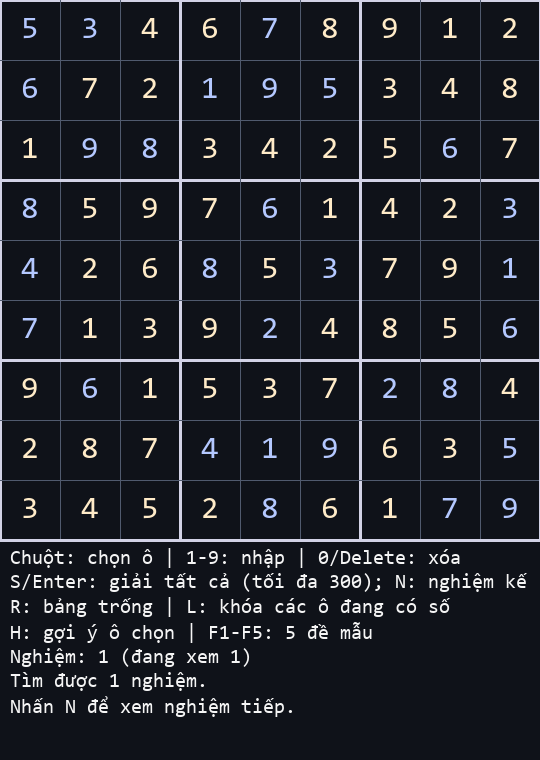

# Sudoku Solver and Playable Board

A Pygame board for entering a Sudoku puzzle, highlighting conflicts, requesting a hint, and watching a backtracking solver search for solutions.

## Preview: one solution found by MRV backtracking

*The live demo keeps the original givens in blue and shows the solved cells in a lighter color. This example has one solution.*
## Solver

The solver uses the minimum-remaining-values (MRV) heuristic: at each step it selects the empty cell with the fewest legal candidates. This narrows the search earlier than choosing the first empty cell.

## Controls

- Click a cell and press 1–9 to enter a value.
- S or Enter — solve.
- H — request a hint.
- N — cycle through found solutions.
- F1–F5 — load a sample puzzle.
- R — clear the board.
- L — lock entered values as givens.

## Run

    python -m pip install -r requirements.txt
    python main.py

The solver caps its result list at 300 solutions so an empty grid cannot create an unbounded collection. It is an educational solver and interface, not a puzzle generator or difficulty-rating system.
